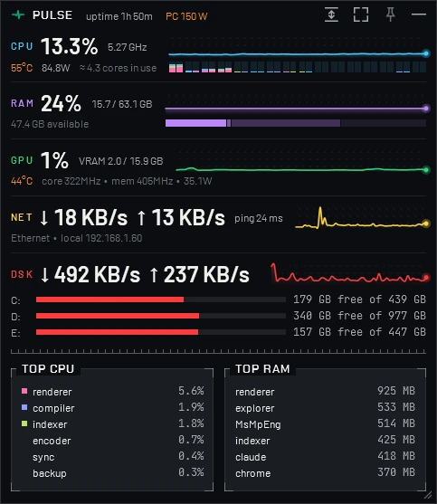
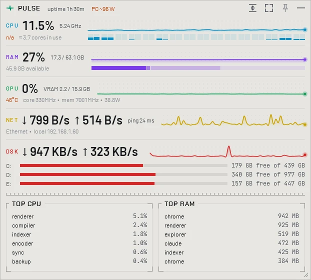

# Pulse

**A small system monitor widget for Windows.**

[](https://github.com/caste9612/Pulse/releases/latest)

[](LICENSE)

Task Manager is big, doesn't remember its position and size, and has to be opened every time. Pulse is a
small window that starts with Windows: it shows CPU per core, RAM, GPU, network and disk with graphs of the
last minute, and uses about 2% of one core.

<p>
  
  
</p>

## Download

Download `Setup-Pulse-vX.Y.Z.exe` (installer) or `Pulse-vX.Y.Z-portable.zip` from the
[latest release](https://github.com/caste9612/Pulse/releases/latest).

- **Windows 10 or 11**, 64-bit, with the [.NET 9 Desktop Runtime](https://dotnet.microsoft.com/download/dotnet/9.0).
  The Mica transparency needs Windows 11 22H2 or later; elsewhere the widget is opaque.
- The installer upgrades in place and keeps your settings (`%APPDATA%\Pulse\settings.json`). It offers:
  *Start with Windows*, *Start with administrator privileges* with *Install the PawnIO driver* under it, and
  *Restart Pulse if it closes because of an error* (ticked by default).
- The portable build runs from any folder: extract it and start `Pulse.exe`.
- Pulse is not code-signed, so SmartScreen may say *"Windows protected your PC"* the first time: choose
  **More info**, then **Run anyway**.

## What it shows

- **CPU**: usage, clock, temperature and power; one bar per logical processor (the threads of a core side by
  side) and the load counted in full cores. As administrator the bars also show, in color, how much of each
  core the busiest processes take.
- **RAM**: usage, available memory and the composition bar of Task Manager (in use, modified, cached, free);
  the tooltip adds committed memory and page file usage.
- **GPU**: usage, video memory, temperature, clocks and power; NVIDIA cards are read directly through NVML,
  and on a PC without a graphics card Pulse shows the integrated GPU.
- **Network**: download and upload speed, Wi-Fi name and signal, local and public IP, ping.
- **Disk**: read and write speed, free space on each drive.
- **Top processes**: the six using the most CPU and the most memory, every five seconds; right-click one to
  open its folder, see its properties or end it.
- **System**: uptime and an estimate of the whole PC's power draw.

Every value has a graph of the last 60 seconds. The header has a **fit** button (the smallest size that shows
everything) and a **corner** button (sends the widget to a corner of its screen). The tray menu switches
between dark, light and Windows theme, opens *Appearance…* (accent, transparency, density) and toggles
*Always on top* and *Start with Windows*.

## Running as administrator

Some values need administrator rights:

- **CPU temperature, power and the fastest core's clock** need the rights *and* the **PawnIO** driver, through
  which LibreHardwareMonitor reads the CPU's registers. Without them they read `n/a`, and the clock is the
  average speed of the cores at work, as in Task Manager.
- **The processes on each core** (the colors in the core bars) need the rights only.

Everything else works without them. The clean way is the installer:

- **Start with administrator privileges** registers a Scheduled Task that starts Pulse elevated at logon,
  with no UAC prompt each time, as HWiNFO64 or MSI Afterburner do. A Pulse started without the rights (the
  Start menu, the end of the installer) hands over to that task and is back elevated in about a second.
- **Install the PawnIO driver** downloads PawnIO's official setup, checks it and installs it. PawnIO can also
  be installed from [pawnio.eu](https://pawnio.eu) or with `winget install namazso.PawnIO`.

The details per CPU family are in [docs/HARDWARE-SUPPORT.md](docs/HARDWARE-SUPPORT.md), the installer and
its tasks in [docs/INSTALLER.md](docs/INSTALLER.md).

## Footprint

On the reference PC (Ryzen 9 7950X, RTX 5070 Ti, Windows 11), v1.3.0 uses about 2.1% of one core with the
widget visible and 1.5% hidden in the tray, with about 130 MB of private memory. The metrics are read with direct
Win32 calls instead of .NET's PerformanceCounter or WMI, and the slower ones are polled less often. The
measurements of each release and the choices behind them are in [docs/PERFORMANCE.md](docs/PERFORMANCE.md).

## Build from source

```bash
git clone https://github.com/caste9612/Pulse
cd Pulse/ResourceMonitor
dotnet publish -c Release -r win-x64 --self-contained false -p:PublishSingleFile=true -o ../dist
```

The output is `dist/Pulse.exe`. The Reticle UI library ships as DLLs in `lib/Reticle`, so the clone builds as
it is. Full instructions in [docs/BUILD.md](docs/BUILD.md), the structure of the code in
[docs/ARCHITECTURE.md](docs/ARCHITECTURE.md).

## License

[MIT](LICENSE). Pulse bundles LibreHardwareMonitorLib (MPL 2.0) and four fonts under the SIL Open Font
License: see [licenses/](licenses/README.md).
