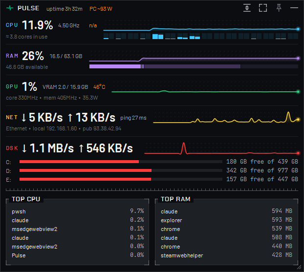

# Pulse

A lightweight, always-on Windows widget that shows live system metrics — CPU, RAM, GPU, network, disk, top processes — without the bloat of Task Manager.



## Why

Task Manager works but it's too big, doesn't remember its size/position, and you have to launch it manually every time. Pulse aims to be a small, always-on widget that **respects your system's resources** — a monitoring tool that consumes a fraction of a percent of CPU and ~190 MB RAM has no business existing if it doesn't actually stay lean.

Pulse:

- Starts automatically with Windows (optional)
- Remembers position and size between sessions
- Lives in the system tray (one click to hide/show)
- Shows live sparklines for the last 60 seconds with smooth Bezier curves
- Stays under **2% CPU of a single core** in steady state (~0.05% of total system on modern CPUs)

## Lightweight by design

Pulse was built with obsessive focus on minimising its own footprint. After several profiling iterations the current numbers on the reference setup (**AMD Ryzen 9 7950X, 32 threads, NVIDIA RTX 5070 Ti, 64 GB DDR5, Windows 11**) are:

| Metric | Value | What it means |
|---|---|---|
| **Cold-start time** | ~540 ms | Time from launch to message loop ready (single-file extract included) |
| **Working Set (RAM)** | ~194 MB | What Task Manager shows; mostly shared with other .NET apps |
| **Private memory** | ~144 MB | RAM uniquely owned by Pulse |
| **CPU avg (incl. startup)** | ~4% | 120s window — startup spike dominates |
| **CPU steady-state (≥30 s)** | **~1.5%** of one core | ≈ 0.05% of total system on a 32-thread CPU |
| **CPU max spike** | ~12% of one core | During first slow-tick init |
| **Handles** | ~850 | Stable, no leak |
| **Threads** | ~20 | Stable |
| **RAM growth over 2 min** | ~0 MB | No leaks measured |
| **Single-file exe** | 7 MB (10.3 MB from v1.2.0) | + 1.5 MB of native LHM dependencies; v1.2.0 embeds the Reticle UI library and its fonts |
| **Installer** | 4.4 MB | + portable zip 3.7 MB |

The table was measured on v1.1.0. For v1.2.0 see below.

### v1.2.0: the Reticle UI

v1.2.0 moves the widget to Reticle, the author's WPF design system, and drops the old layered transparent window (`AllowsTransparency`) with a blurred drop shadow: every update redrew the shadow over the whole window and copied the window back from the GPU. The window is now a regular one with the Windows 11 Mica backdrop. Measured with the PC idle, same 622 × 502 window, v1.1.0 against v1.2.0 alternated in two 45 s rounds (not elevated, so the figures are not comparable with the table above, only with each other):

| Metric | v1.1.0 | v1.2.0 |
|---|---|---|
| CPU, widget visible | 5.8% of one core | **4.9%** |
| CPU, widget hidden in the tray | 4.8% | **4.4%** |
| GPU (3D engine) | 0.21% | **0.09%** |
| Dedicated video memory | 34 MB | **17 MB** |
| Private memory / working set | 145 / 200 MB | 130 / 211 MB |
| Cold start (message loop ready) | ~506 ms | ~540 ms |

### How we got here (the things that matter)

1. **No PerformanceCounter** — every metric is read via direct Win32 P/Invoke (`GetSystemTimes`, `GetPerformanceInfo`, `GetIfTable2`, `NtQuerySystemInformation`, `CallNtPowerInformation`). Each tick is ~5 ms instead of the ~45 ms it would cost using `PerformanceCounter`/PDH.
2. **No `System.Windows.Forms`, no `System.Drawing`** — the tray icon is a hand-rolled Win32 `Shell_NotifyIconW` wrapper, the icon is loaded via `ExtractIconEx` from the exe itself. This drops 20–30 MB of assemblies that WPF apps usually pull in.
3. **No `System.Management`/WMI** — we replaced the only two WMI queries (CPU temp fallback, VRAM total) with cheaper alternatives.
4. **Pooled buffers in the sparkline** — the `Point[]` array and gradient brushes are reused across renders instead of being allocated every frame.
5. **Lazy initialisation of LibreHardwareMonitor** — sensor enumeration happens in the background after the UI is already on screen.
6. **Staggered polling** — fast metrics (CPU/RAM/Net/Disk) tick at 1 s, hardware sensors at 2 s, top processes at 5 s, drive list at 30 s. No one tick does too much.
7. **ReadyToRun precompile** — managed IL is precompiled to native code at publish time (`-p:PublishReadyToRun=true`), shaving ~30% off the cold-start JIT cost.

A full performance log lives in `%TEMP%\pulse-perf.log`: any tick that exceeds 50–500 ms (depending on the operation) gets recorded so we can spot regressions.

## Features

- **CPU**: usage %, current clock (GHz), temperature, power (W) — see "Running as administrator" below; under the graph one bar per logical processor (threads of the same core side by side) and the load counted in full cores, to see how parallel the work is; as administrator the bars also show, in colour, how much of each core the busiest processes of *Top CPU* take (up to three, from half a core up)
- **RAM**: usage %, used/total GB, available GB and, under the graph, the composition bar of Task Manager (in use, modified, cached, free); the tooltip explains each part and adds committed memory and page file usage
- **GPU**: usage %, VRAM used/total, temperature, core/memory clocks, power (W)
- **Network**: ↓/↑ throughput, Wi-Fi SSID/signal, local IP, public IP, ping to 8.8.8.8
- **Disk**: total ↓/↑ throughput, per-drive free space + bar, SSD temp (when LHM Storage is enabled)
- **Top processes**: top 6 by CPU (those above half a core with their colour in the core bars, the load in cores in the tooltip) and by RAM, updated every 5 s. Right-click on a process for: *Open file location* · *Properties* · *End process* · *Search online*
- **System**: uptime, estimated total PC power draw (W)
- **Fit button** in the header: the widget takes the smallest size that shows everything, with no scroll bar and no value cut, even at its longest
- **Corner button** next to the pin: a click opens four arrows, and the chosen one sends the widget to that corner of its screen, 12 units from the edges and never over the taskbar
- **Themed** with the Reticle UI (from v1.2.0): dark, light or follow Windows from the tray menu; accent colour, Mica transparency, fill and density from *Appearance...*; smooth Bezier sparklines on a dotted grid, tabular digits so live values never shift the row, custom drag/resize, always-on-top toggle

## Running as administrator (important)

**This is the single most impactful setting.** Several CPU sensors live in Model-Specific Registers (MSRs) which only kernel mode can read. Without admin privileges Pulse cannot show:

- CPU temperature (per-core and package)
- CPU package power (W)
- Accurate per-core clock frequency
- Which process runs on which core (the colours in the core bars): the kernel sampling session needs elevation too

Everything else (CPU/RAM/GPU usage, GPU temp/power, network, disk, top processes) works fine without elevation — these don't need MSR access.

### The clean way: tick "Start with administrator privileges" in the installer

When you run `Setup-Pulse-vX.Y.Z.exe`, the wizard offers two startup options:

- ☐ **Start with Windows** — registers `HKCU\…\Run` so Pulse launches on login (regular user privileges, no UAC prompt)
- ☐ **Start with administrator privileges** ← *check this if you want CPU temp/power*

The second checkbox creates a **Windows Scheduled Task** with trigger *On Logon* and *Run with highest privileges*. This is the standard workaround used by HWiNFO64, ThrottleStop, MSI Afterburner et al. to avoid the UAC prompt at every login. Once configured, Windows itself launches Pulse with an elevated token at boot — no clicking, no warnings. The task has no run-time limit (the Task Scheduler default stopped Pulse after 72 hours) and starts on battery too.

A third checkbox, ticked by default, **restarts Pulse if it closes because of an error**, with the same rights it normally starts with: a second Scheduled Task, *Pulse restart*, that fires on the crash event Windows writes for `Pulse.exe` (see [`docs/INSTALLER.md`](docs/INSTALLER.md)). The case it was made for: an NVIDIA driver update crashed an elevated Pulse, which stayed closed until it was reopened by hand, without the administrator rights.

The Scheduled Tasks are removed when you uninstall Pulse.

### Why admin alone isn't always enough

Modern Windows 11 ships with **VBS** (Virtualization-Based Security) and **HVCI** (Hypervisor-protected Code Integrity) enabled. These features sandbox the kernel and can block older Ring-0 drivers — including the one LibreHardwareMonitor uses by default.

If you have **AMD Ryzen Master** installed, its driver (`AMDRyzenMasterDriverV31.sys`) is loaded as a permanent Windows service and is signed by AMD, so it passes VBS without complaints. Pulse detects this driver and uses it — *no extra installation, no manual configuration*.

If you have an **Intel CPU**, for now Pulse relies on the LHM library's own driver, which may be blocked under VBS (CPU temp/power then show "n/a"). HWiNFO64 (free for personal use) has a driver signed via newer Microsoft attestation that passes VBS: future Pulse versions will read directly from HWiNFO64's shared memory, but today installing it doesn't change what Pulse shows.

See [`docs/HARDWARE-SUPPORT.md`](docs/HARDWARE-SUPPORT.md) for the full breakdown per CPU family.

## Install

### Option A — Installer (recommended)

Download the latest `Setup-Pulse-vX.Y.Z.exe` from the [Releases page](../../releases). The installer offers:

- ☑ Start with Windows (login)
- ☑ **Start with administrator privileges** (see section above — enables CPU temp/power on supported hardware)
- ☑ Create desktop shortcut

Inno Setup detects an existing Pulse install via its `AppId` and **upgrades in place without losing settings** (settings live in `%APPDATA%\Pulse\settings.json` and are preserved across uninstall/reinstall).

### Option B — Portable build

Grab `Pulse-vX.Y.Z-portable.zip` from Releases, extract anywhere, and run `Pulse.exe`. Settings are stored in `%APPDATA%\Pulse\settings.json`. To enable CPU temp/power in portable mode you have to launch the exe manually with *Run as administrator* every time.

## Hardware requirements

- Windows 10 / 11 (x64); the Mica and Acrylic transparency needs Windows 11 22H2 or later (elsewhere the widget is opaque)
- .NET 9 Desktop Runtime ([download](https://dotnet.microsoft.com/download/dotnet/9.0))

Optional, to unlock CPU temperature / power:

| System | What you need | Works under VBS / HVCI |
|---|---|---|
| AMD Ryzen | Install [AMD Ryzen Master](https://www.amd.com/en/products/processors/ryzen-master.html) → its signed driver stays loaded as a Windows service | ✅ Yes |
| Intel Core (Gen 8–14) | Nothing to install for now: LHM's own driver, with admin rights ([HWiNFO64](https://www.hwinfo.com) support is planned) | ⚠️ May be blocked |
| No supported tool installed | CPU temp/power show as `n/a`, everything else still works | ✅ |

## Tray menu

Right-click the tray icon (near the clock) for:

- Show / Hide — toggle widget visibility
- Theme — Dark / Light / Follow Windows
- Appearance... — accent colour, transparency, fill and density, applied live
- Always on top — pin toggle
- Start with Windows — autostart (regular user privileges)
- Restart as administrator — re-launch elevated, enables MSR sensors and the process colours in the core bars (only shown when not already admin)
- Exit

## SmartScreen warning when downloading

Pulse is **not currently code-signed** (an EV certificate costs ~$300/year and we'd rather spend that on something else for now). The first time you download `Setup-Pulse-vX.Y.Z.exe`, Windows SmartScreen may show *"Windows protected your PC"* with a *"Don't run"* button.

Click **"More info"** → **"Run anyway"**. This is the same flow Notepad++, HWiNFO and many other open-source tools require until they earn enough reputation or pay for an EV cert.

## Build from source

See [`docs/BUILD.md`](docs/BUILD.md) for full instructions. TL;DR:

```bash
git clone https://github.com/caste9612/Pulse
cd Pulse/ResourceMonitor
dotnet publish -c Release -r win-x64 --self-contained false -p:PublishSingleFile=true -o ../dist
```

Output: `dist/Pulse.exe` (~10 MB, with ReadyToRun precompiled). The Reticle UI library ships as DLLs in `lib/Reticle`, so the clone builds as is.

## Architecture

WPF UI on top of background services polling at staggered intervals. See [`docs/ARCHITECTURE.md`](docs/ARCHITECTURE.md).

```
MainWindow (WPF + Reticle UI, Mica backdrop)
   │
   ├── MetricsService    (1 s : CPU/RAM/Disk/Net via Win32 native)
   ├── NativeMetrics     (P/Invoke: GetSystemTimes, GetIfTable2, ...)
   ├── HardwareMonitor   (2 s : LibreHardwareMonitorLib — temps/clocks/watts)
   ├── ProcessMonitor    (5 s : top processes via Process.GetProcesses)
   ├── NetworkMonitor    (2 s : ping, IPs, SSID via netsh)
   ├── DriveMonitor      (30 s: DriveInfo.GetDrives)
   └── TrayIcon          (Win32 Shell_NotifyIconW, no WinForms)
```

## License

MIT. See [LICENSE](LICENSE).

Bundles LibreHardwareMonitorLib (MPL 2.0). No other third-party runtime dependencies.
